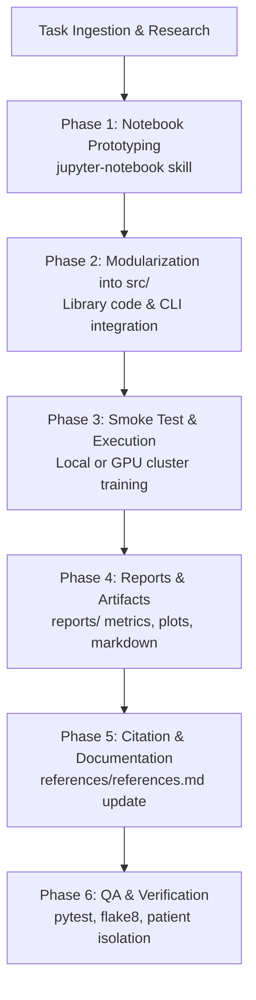

# General Agent Workflow

## Purpose and Scope

This workflow establishes the mandatory lifecycle for AI agents contributing features, experiments, models, data pipelines, or evaluations to the TB Detection Model repository. 

Following this sequence guarantees:
- **Reproducibility**: Experiments are deterministic, parameterized, and auditable.
- **Traceability**: Exploratory work transitions cleanly into tested library code in `src/`, auditable evaluation reports in `reports/`, and documented citations in `references/references.md`.
- **Integrity**: Patient-grouped splits remain uncorrupted, preventing data leakage.



---

## Phase 1: Exploration and Prototyping in Jupyter Notebooks

When exploring a new model architecture, loss function, data augmentation, or diagnostic routine, scaffold a structured Jupyter notebook rather than creating throwaway root scripts.

### 1.1 Scaffold with the `jupyter-notebook` Skill
Use the bundled `new_notebook.py` tool from the `jupyter-notebook` skill to scaffold clean notebook JSON from verified templates:

```bash
# General template invocation
.venv/bin/python .agents/skills/jupyter-notebook/scripts/new_notebook.py \
  --kind experiment \
  --title "<Descriptive Experiment Title>" \
  --out notebooks/<NN>_<descriptive_snake_case>.ipynb
```

#### Naming and Placement Conventions
- Store persistent notebooks in `notebooks/`.
- Use a two-digit chronological prefix matching existing files:
  - `01_data_exploration.ipynb`
  - `02_data_preprocessing.ipynb`
  - `03_densenet121_training_results.ipynb`
  - `04_dinov2_training_results.ipynb`
  - `05_<new_experiment>.ipynb`
- Use `--kind experiment` for hypothesis-driven or empirical studies.
- Use `--kind tutorial` for onboarding walkthroughs or educational demos.

### 1.2 Notebook Structural Standards
Every created notebook must adhere to these structural invariants:
1. **Header Markdown Cell**: Explicitly state:
   - Objective & clinical problem (e.g. binary TB triage on chest radiographs).
   - Baseline models or control conditions.
   - Core research hypotheses or questions to answer.
2. **Setup Cell**:
   - Resolve repository root reliably regardless of current working directory:
     ```python
     import sys
     from pathlib import Path

     REPO_ROOT = Path(".").resolve() if Path("src").is_dir() else Path("..").resolve()
     if str(REPO_ROOT / "src") not in sys.path:
         sys.path.insert(0, str(REPO_ROOT / "src"))
     ```
   - Seed all random number generators (`random`, `numpy`, `torch`).
3. **Focused, Runnable Cells**:
   - One atomic action per code cell.
   - Precede code cells with brief Markdown context explaining intent and expected outcome.
   - Avoid dumping large raw outputs, unfiltered stack traces, or hundreds of lines of progress bars.

---

## Phase 2: Code Modularization and Productionizing in `src/`

Once an approach is validated in the notebook, transition all reusable logic into production modules. Notebooks are not production entry points.

### 2.1 Package Architecture
All permanent code belongs in the `src/` hierarchy:

| Directory | Responsibility | Primary Conventions |
| :--- | :--- | :--- |
| `src/tb_detection_model/` | Canonical package root | Typed, synchronous, modular Python |
| `src/tb_detection_model/data/` | Dataset generation, loaders, transforms | Preserve patient stratification; fixed normalization |
| `src/tb_detection_model/models/` | Model architectures, training, inference | `TBDataset`, `build_model`, `evaluate_model` |
| `src/tb_detection_model/features/` | Feature extraction & transformations | Reusable deterministic feature pipelines |
| `src/tb_detection_model/visualization/` | Reusable plotting and analysis utilities | ROC curves, confusion matrices, loss curves |
| `src/tb_detection_model/cli.py` | Command-line interface via Typer | `tb-detection-model` entry point |
| `src/tb_detection_model/config.py` | Experiment configuration management | `tb-detection.toml` loader & schema validator |
| `src/data/`, `src/models/` | Compatibility script shims | Thin wrappers invoking package modules |

### 2.2 Coding Standards & Constraints
- **Style**: Strict PEP 8 compliance enforced by flake8 (`tox.ini`):
  - Maximum line length: **79 characters**.
  - Maximum McCabe cyclomatic complexity: **10**.
- **Typing & Structure**:
  - Small, single-purpose synchronous functions with type annotations.
  - `@dataclass` for configuration and structured parameter records.
  - Standard `logging` module; do not use unformatted `print()` in `src/`.
- **Data Invariants**:
  - Image inputs: 224x224 uint8 grayscale or replicated 3-channel RGB.
  - Normalization: Fixed mean $\mu = 125.75$, standard deviation $\sigma = 53.67$.
  - Patient isolation: Images from the same patient ID must NEVER appear in multiple splits (train, validation, test).

### 2.3 Expose via CLI and Configuration
Whenever adding a new model or workflow parameter:
1. Update `tb-detection.toml` schema and defaults in `src/tb_detection_model/config.py`.
2. Expose relevant flags in `src/tb_detection_model/cli.py` under the appropriate command group (`data`, `model`, `config`).
3. Test configuration precedence:
   `typed built-in defaults` -> `tb-detection.toml` -> `--config PATH` -> CLI flags.

---

## Phase 3: Execution, Smoke Testing, and Training

Before launching full training runs or large-scale dataset generation:

### 3.1 Establish a Smoke Test Baseline
1. Run a 1-epoch or small-subset sanity run locally:
   ```bash
   .venv/bin/tb-detection-model model train \
     --model-name <model_name> \
     --epochs 1 \
     --batch-size 8 \
     --output-dir models/smoke_test
   ```
2. Verify output files are generated, loss decreases or behaves stably, and memory usage is within bounds.
3. Clean up temporary smoke test artifacts after verification.

### 3.2 GPU and Remote Compute Guidelines
When training on GPU servers or DGX clusters:
- Read and follow `.agents/workflows/gpu-utilization.md`.
- Inspect visible resources before scheduling:
  ```bash
  nvidia-smi
  nvidia-smi -L
  ```
- Use the cluster scheduling flag `--k8s-gpu` when executing on Kubernetes nodes with assigned NVIDIA MIG instances:
  ```bash
  .venv/bin/tb-detection-model model train \
    --k8s-gpu \
    --model-name <model_name> \
    --epochs 3 \
    --batch-size 64 \
    --lr 1e-4 \
    --output-dir models/<model_name>
  ```
- Do not run long unbounded training jobs on login nodes without scheduler allocations.

---

## Phase 4: Recording Reports and Evaluation Artifacts in `reports/`

Every model training or evaluation run must generate versioned, reproducible evaluation records in `reports/`.

### 4.1 Evaluation Invocations
Evaluate trained models against held-out splits using the CLI:

```bash
# Evaluate on test split
.venv/bin/tb-detection-model model evaluate \
  --model-path models/<model_name> \
  --split test \
  --output-dir reports
```

### 4.2 Standard Report Artifacts
All evaluations must persist three categories of artifacts:

```text
reports/
├── metrics_<model_name>_<split>.json     # Machine-readable performance metrics
├── <model_name>_evaluation_report_<split>.md # Human-readable clinical/engineering report
└── figures/                             # Visual diagnostics
    ├── training_curves_<model_name>.png
    ├── roc_curve_<model_name>_<split>.png
    └── confusion_matrix_<model_name>_<split>.png
```

#### 1. Metric JSON Schema (`reports/metrics_<model>_<split>.json`)
Persist exact quantitative measurements with sample distributions:
```json
{
  "model_name": "dinov2",
  "split": "test",
  "samples": 331,
  "accuracy": 0.6495,
  "sensitivity_recall": 0.6845,
  "specificity": 0.6135,
  "precision": 0.6461,
  "f1_score": 0.6647,
  "roc_auc": 0.7050,
  "confusion_matrix": {
    "tn": 100,
    "fp": 63,
    "fn": 53,
    "tp": 115
  }
}
```

#### 2. Visual Diagnostics (`reports/figures/`)
- **Training Curves**: Epoch vs train/val loss and accuracy to monitor convergence or overfitting.
- **ROC Curve**: True Positive Rate vs False Positive Rate with AUC annotation.
- **Confusion Matrix**: Annotated 2x2 grid displaying True Normal, False Positive, False Negative, and True Positive counts with rates.

#### 3. Markdown Evaluation Report (`reports/<model>_evaluation_report_<split>.md`)
Structure the Markdown evaluation report with:
- Model family, parameters, training hyperparameters, and hardware.
- Quantitative table comparing Accuracy, Recall/Sensitivity (TB), Specificity (Normal), Precision, F1-Score, and ROC-AUC.
- Textual confusion matrix breakdown.
- **Clinical Triage Interpretation**: Note the trade-off between Sensitivity (detecting active TB to prevent transmission) versus Specificity (reducing unnecessary confirmatory sputum/GeneXpert tests).

---

## Phase 5: Tracking Literature and References in `references/references.md`

Whenever referencing external research, foundational model cards, pre-training methodologies, chest X-ray benchmark datasets, or novel loss functions, document them immediately in `references/references.md`.

### 5.1 Format Requirements
Append new references as Markdown list items:

```markdown
- [Resource Name or Paper Title]: [Canonical URL or DOI]
  - [Brief description of what was utilized or adapted in this project]
```

### 5.2 Example Entry
```markdown
- DINOv2: Learning Robust Visual Features without Supervision: https://arxiv.org/abs/2304.07193
  - Vision Transformer foundation model used for self-supervised feature extraction in `tb_detection_model/models/train_model.py`.
- Torchvision DenseNet Architecture: https://pytorch.org/vision/main/models/densenet.html
  - Convolutional baseline model implemented for benchmark comparison on the patient-stratified split.
```

---

## Phase 6: Quality Assurance and Verification Checklist

Never yield or complete an agent task without executing mandatory local QA verification.

### 6.1 Verification Commands
Run the full test and lint suite in the project virtual environment:

```bash
# 1. Run unit and integration tests
.venv/bin/python -m pytest -q

# 2. Check code style and PEP 8 compliance (max 79 chars, complexity <= 10)
.venv/bin/python -m flake8 src tests

# 3. Verify Python environment integrity
make test_environment
```

### 6.2 Pre-Delivery Sanity Checks

| Area | Invariant to Verify |
| :--- | :--- |
| **Patient Grouping** | Confirm no patient identifier appears in more than one split (`train`, `val`, `test`). |
| **Image Preprocessing** | PNG files are 224x224 uint8; normalization matches fixed $\mu = 125.75, \sigma = 53.67$. |
| **Directory Hygiene** | `data/raw/` remains untouched; `data/interim/` and `data/processed/` are not committed to git. |
| **Artifact Completeness** | Corresponding `.json` metrics, `.png` figures, and `.md` reports are saved in `reports/`. |
| **References** | Relevant external documentation links added to `references/references.md`. |
| **Code Style** | No flake8 warnings or errors; 79-character line limits strictly respected. |
